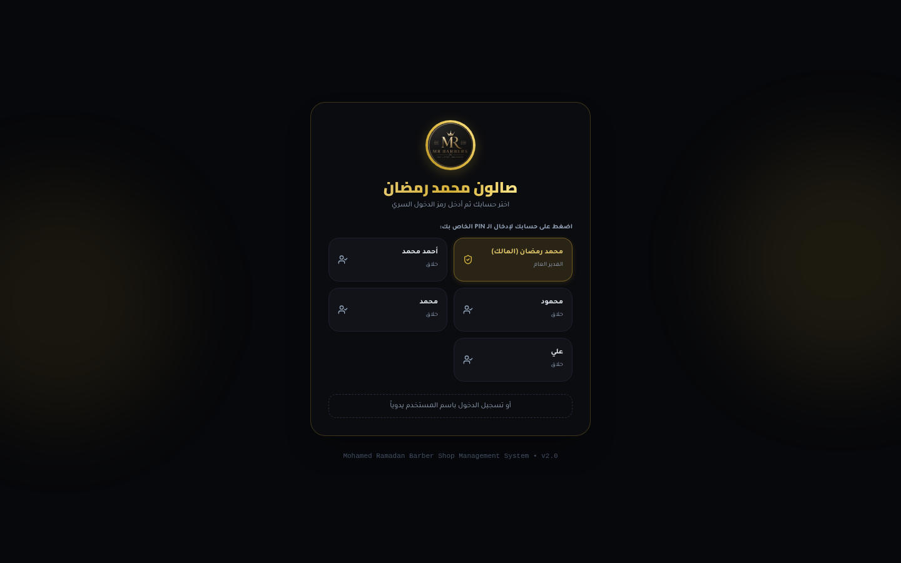
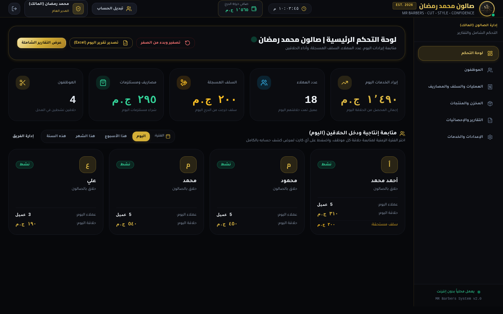
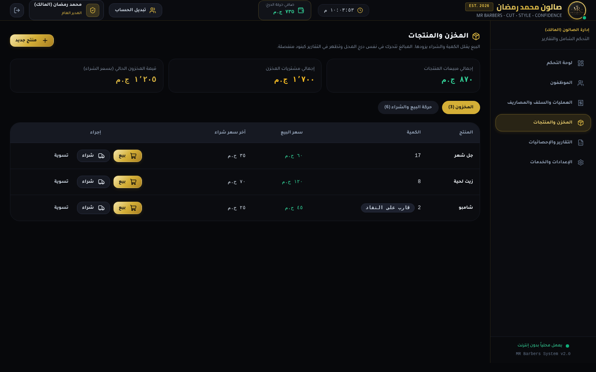
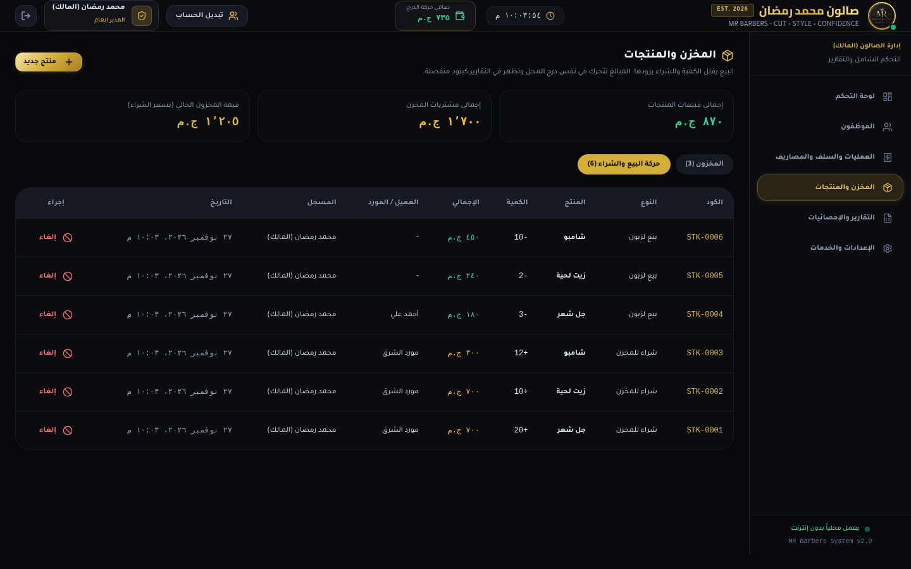
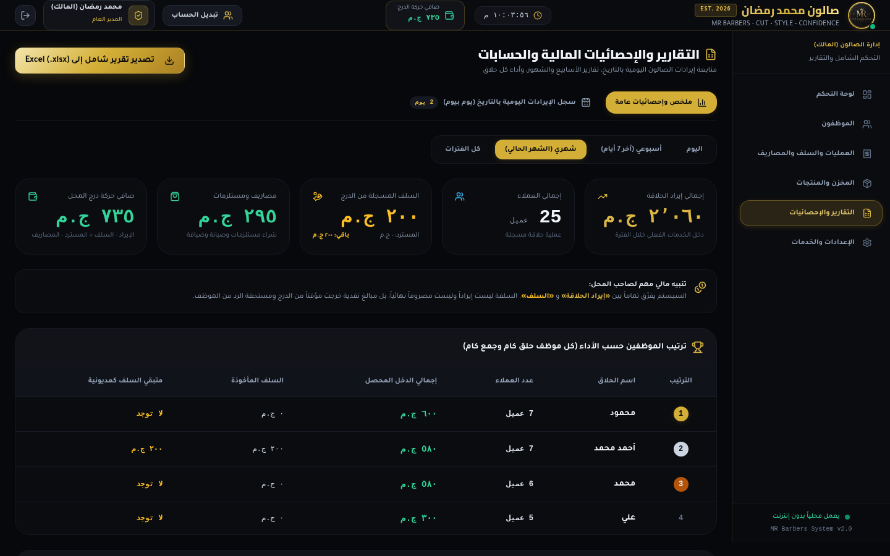

# 👑 MOHAMED RAMSHAN | MR BARBERS MANAGEMENT SYSTEM
### نظام إدارة صالون محمد رمشان الفاخر للرجال — Offline-First POS & Enterprise ERP

<p align="center">
  
</p>

<p align="center">
  <b>EST. 2026 • CUT • STYLE • CONFIDENCE</b><br>
  <i>نظام متكامل لإدارة صالونات الحلاقة الرجالية، مصمم بأحدث المعايير البرمجية ليعمل محلياً بالكامل بدون إنترنت وبأعلى درجات الفخامة والأمان المالي.</i>
</p>

---

## 🖼️ لقطات من النظام (Screenshots)

| تسجيل الدخول | لوحة التحكم |
| :---: | :---: |
|  |  |

| المخزن والمنتجات | حركة البيع والشراء |
| :---: | :---: |
|  |  |

| التقارير والإحصائيات |
| :---: |
|  |

> اللقطات من بيانات تجريبية.

---

## ✨ المميزات (Key Features)

| الوحدة | الوصف |
| --- | --- |
| تسجيل الحلاقة | كل حلاق يسجل عملياته ومبالغها من شاشته، والأدمن يراجع ويعدل بملاحظة موثقة |
| الدخول والتبديل السريع | دخول بالـ PIN وتبديل سريع بين الحلاقين على نفس الجهاز مع تسجيل الورديات |
| السلف | طلب سلفة، اعتماد الأدمن، تسجيل السداد، وخصمها من درج المحل |
| المصاريف والمستلزمات | تسجيل مشتريات المحل التشغيلية (ضيافة، مستلزمات، صيانة) |
| **المخزن والمنتجات (جديد)** | منتجات للبيع للزبائن وشراء للمخزن. البيع يقلل الكمية والشراء يزودها، مع سجل حركة كامل |
| التقارير | لوحة تحكم، تقارير يومي/أسبوعي/شهري، وتصدير Excel متعدد الصفحات |
| الإعدادات والنسخ الاحتياطي | الخدمات والأسعار، نسخ احتياطي واستعادة، وإعادة ضبط |
| بدون إنترنت | كل البيانات محلية في المتصفح، ولا يحتاج أي سيرفر |

### 📦 المخزن والمنتجات

- **الصلاحية**: للأدمن فقط (إضافة منتج، بيع، شراء، تسوية جرد، إلغاء حركة).
- **المخزون مربوط بالحركات**: الكمية لا تتغير إلا من خلال سجل حركة (`بيع` ينقص، `شراء` يزيد، `تسوية` للجرد). لا يمكن البيع بأكثر من المتاح.
- **نفس الدرج**: المبالغ تدخل وتخرج من نفس درج المحل (`الدرج = الحلاقة - السلف + السداد - المصاريف + مبيعات المنتجات - مشتريات المنتجات`) لكن تظهر في التقارير كبنود منفصلة، ولا تدخل في إيراد الحلاقين.
- **لا حذف**: الحركة الخاطئة تتلغى (تتعلّم كملغاة ويتعكس أثرها) ولا تتمسح. إلغاء شراء تم بيع بضاعته مرفوض.
- القرار المعماري وأسبابه: [docs/adr/0001-inventory-shared-drawer.md](docs/adr/0001-inventory-shared-drawer.md)

---

## 🛠️ التقنيات المستخدمة (Tech Stack)

| الطبقة | التقنية |
| :--- | :--- |
| **واجهة المستخدم** | React 18, TypeScript, Vite, Tailwind CSS |
| **الهوية البصرية** | Luxury Obsidian Black (`#0B0C10`) & Brushed Gold (`#D4AF37`) |
| **الخطوط والاتجاه** | دعم كامل للغة العربية (RTL) مع خطوط Cairo و Tajawal |
| **الأيقونات** | Lucide React |
| **تصدير الجداول** | SheetJS (XLSX) - 100% Offline client-side engine |
| **المؤثرات الصوتية** | Web Audio API Synthesizer (بدون إنترنت أو ملفات mp3) |
| **التخزين المحلي** | IndexedDB / LocalStorage Engine مع النسخ الاحتياطي الكامل |
| **تطبيق سطح المكتب** | مهيأ للتشغيل الفوري أو التغليف بواسطة Tauri 2 / Electron |

---

## 🚀 تشغيل المشروع محلياً (Quick Start)

### 1. المتطلبات:
- تثبيت [Node.js](https://nodejs.org/) (الإصدار 18 أو أحدث).

### 2. تثبيت الحزم وتشغيل وضع التطوير:
```bash
# تثبيت الحزم
npm install

# تشغيل خادم التطوير المحلي
npm run dev
```

سيفتح التطبيق على الرابط: `http://localhost:5173`

### 3. بناء النسخة الإنتاجية (Production Build):
```bash
npm run build
```
سيتم إنشاء مجلد `dist/` الجاهز للنشر المباشر.

---

## 🔑 حسابات الدخول التجريبية الجاهزة

| الحساب | المستخدم | رمز PIN | الدور |
| :--- | :--- | :--- | :--- |
| **المالك / المدير العام** | `admin` | `1234` | صلاحيات كاملة لكل أجزاء النظام والتقارير |
| **أحمد شريف (حلاق رئيسي)** | `ahmed` | `1111` | نقطة البيع، تذاكره اليومية، طلب سلفة، ورديته |
| **محمود عثمان (مصفف)** | `mahmoud` | `2222` | نقطة البيع، تذاكره اليومية، طلب سلفة |
| **يوسف كريم (عناية وبشرة)** | `youssef` | `3333` | نقطة البيع، تذاكره اليومية، طلب سلفة |

---

## 📂 المعمارية وهيكل الملفات (Project Structure)

```text
mr/
├── public/
│   └── brand/logo.jpg              # الشعار الرسمي الفاخر للصالون
├── src/
│   ├── app/App.tsx                 # الحاوية الرئيسية للتطبيق وتوزيع الشاشات
│   ├── components/
│   │   ├── layout/                 # شريط الرأس، القائمة، شاشة القفل، التبديل السريع
│   │   └── ui/                     # مكونات الواجهة الفاخرة (أزرار، نوافذ، بطاقات)
│   ├── context/AppContext.tsx      # إدارة الحالة العامة للمستخدم والجلسة
│   ├── features/                   # موديولات النظام الوظيفية
│   │   ├── auth/                   # تسجيل الدخول
│   │   ├── pos/                    # نقطة البيع السريعة وطباعة الإيصال
│   │   ├── dashboard/              # لوحة تحكم الإدارة
│   │   ├── employee-home/          # بوابة الحلاق وإحصائياته
│   │   ├── transactions/           # سجل التذاكر والعمليات
│   │   ├── corrections/            # طلبات تعديل وإلغاء التذاكر
│   │   ├── employees/              # إدارة الحلاقين والعمولات
│   │   ├── services/               # قائمة الخدمات والأسعار
│   │   ├── advances/               # إدارة السلف والأقساط
│   │   ├── cashbox/                # الخزينة وتسوية الورديات
│   │   ├── expenses/               # المصروفات التشغيلية
│   │   ├── reports/                # التقارير وتصدير إكسيل
│   │   ├── audit/                  # سجل الرقابة والأمان
│   │   └── settings/               # إعدادات الصالون والنسخ الاحتياطي
│   ├── lib/
│   │   ├── db/storage.ts           # محرك التخزين المحلي الآمن والنسخ الاحتياطي
│   │   ├── db/mockData.ts          # بيانات البدء التوضيحية
│   │   └── utils.ts                # أدوات التنسيق وتوليد الأصوات
│   ├── services/                   # منطق الأعمال المستقل (Business Logic Layer)
│   ├── styles/                     # أنماط Tailwind CSS وهوية الصالون الفاخرة
│   ├── types/index.ts              # العقود والأنواع البرمجية (TypeScript Definitions)
│   └── main.tsx                    # نقطة الانطلاق
├── docs/
│   ├── ARCHITECTURE.md             # دليل المعمارية البرمجية بالتفصيل
│   └── CLIENT_HANDOVER_GUIDE.md    # دليل تسليم وبيع النظام للعملاء
└── scripts/
    └── start-windows.bat           # سكريبت تشغيل بنقرة واحدة لأجهزة ويندوز
```

---

## 💼 بيع النظام وتخصيصه للعملاء (White-labeling & Reselling)

تم بناء المشروع بحيث يمكنك إعادة تسميته وبيعه لأي صالون حلاقة آخر بسهولة تامة:
1. استبدال ملف الشعار في `public/brand/logo.jpg`.
2. الدخول بحساب المدير والتوجه إلى **الإعدادات** لتغيير اسم الصالون، أرقام الهواتف، والعنوان.
3. مراجعة دليل التسليم الكامل في: [`docs/CLIENT_HANDOVER_GUIDE.md`](docs/CLIENT_HANDOVER_GUIDE.md).

---

<p align="center">
  <b>تم البناء بواسطة Google DeepMind Antigravity • جاهز للرفع على GitHub والبيع الفوري</b>
</p>
